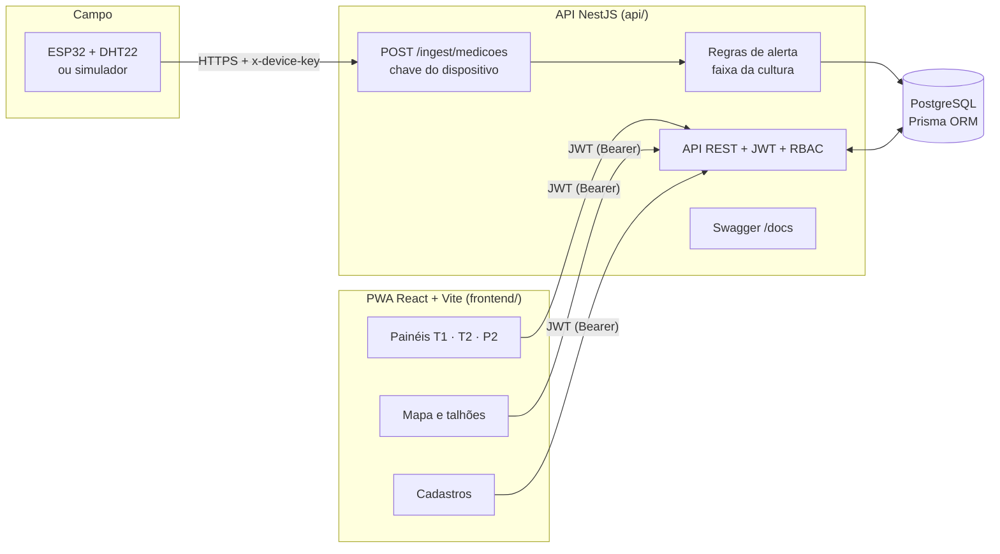
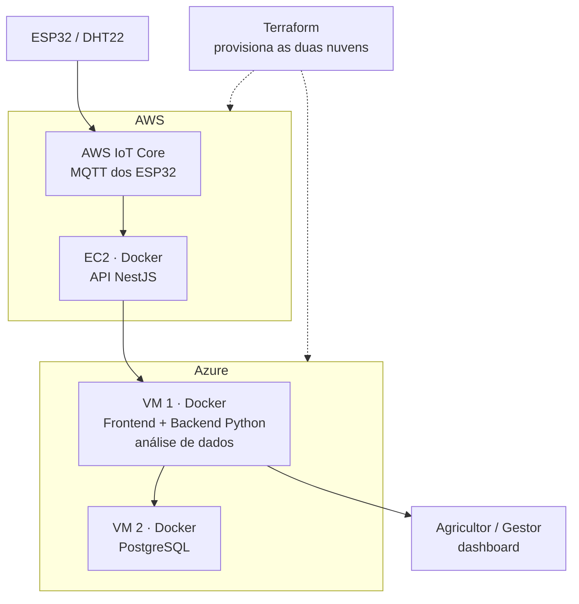

# SIVALE — Arquitetura

Plataforma web em nuvem para monitoramento climático e logístico da fruticultura do Vale do São Francisco.
Esta é a arquitetura da **1ª entrega (13/10/2026)**; a seção final descreve o alvo da 2ª entrega.

## 1ª entrega — fluxo ponta a ponta



**Fluxo principal (requisito 15):** `ESP32/simulador → API REST → PostgreSQL → Dashboard (PWA)`.

1. O dispositivo envia temperatura e umidade em `POST /ingest/medicoes`, autenticado pela chave própria (`x-device-key`).
2. A API valida a leitura (dispositivo ativo, valores plausíveis) e grava uma `medicao`.
3. Se a leitura sai da faixa da cultura do talhão, cria um `alerta` automaticamente (sem repetir enquanto o anterior estiver aberto).
4. Um verificador periódico cria alerta de **falha de sensor** quando um dispositivo ativo fica sem enviar leituras.
5. O PWA consome a API autenticada por JWT e atualiza mapa e painéis a cada 30 s.

## Componentes

| Camada | Tecnologia | Papel |
|---|---|---|
| Front-end | React 18 + TypeScript + Vite, Leaflet, Recharts, PWA (manifest + service worker) | Mapa de satélite, painéis, cadastros; responsivo para tablet e celular |
| API | NestJS 12 + TypeScript | REST, validação (class-validator), JWT, RBAC por perfil e por propriedade, Swagger |
| ORM / banco | Prisma 7 + PostgreSQL | Migrations versionadas em `api/prisma/migrations` |
| IoT | ESP32 + DHT22 (hardware) / `api/scripts/simulate.ts` (simulador) | Envio de temperatura e umidade |
| Integração | ThingSpeak (opcional) | Leitura de canal e gravação como medição |

## Segurança e perfis

- Login com e-mail e senha (hash bcrypt) devolve JWT de 8 h. `POST /auth/logout` incrementa a versão da sessão e revoga tokens anteriores. Todas as rotas exigem token, exceto `/auth/login`, `GET /` e `/ingest/medicoes` (esta usa a chave do dispositivo).
- Perfis: `ADMINISTRADOR`, `GESTOR`, `TECNICO`, `AGRICULTOR`. **Só o administrador cadastra, edita e inativa**; os demais consultam e marcam alertas como vistos/resolvidos. Técnico e agricultor têm as mesmas telas na 1ª entrega; a V2 os diferencia (RBAC). Detalhes e matriz de telas em [PERFIS_E_TELAS](PERFIS_E_TELAS.md).
- **Escopo por propriedade:** o administrador enxerga tudo; o gestor, as propriedades das empresas vinculadas (`usuarioEmpresa`); técnico e agricultor, só as propriedades em `usuarioPropriedade`. O filtro vale para talhões, dispositivos, medições, alertas, logística e painéis e fica em `AcessoService`.
- Não há autocadastro nem registro manual de leitura: usuários são criados pelo administrador e as leituras entram só pela chave do dispositivo.
- A chave do dispositivo é aleatória (192 bits), aparece uma única vez e fica guardada só como SHA-256.
- A senha nunca é devolvida pela API.

## Regras de negócio

| Regra | Onde |
|---|---|
| Leitura fora da faixa da cultura gera alerta (`CRITICO` se passar de 15 % da largura da faixa, senão `ATENCAO`) | `alertas.ts` |
| Alerta igual (mesmo dispositivo e título) não repete por `ALERTA_JANELA_MIN` (60 min) enquanto não for resolvido | `alertas.ts` |
| Dispositivo ativo sem leitura há mais de `LIMITE_SEM_COMUNICACAO_MIN` (30 min) gera alerta `FALHA_SENSOR` | `alertas.ts`, verificação a cada 5 min |
| Leitura recusada se o dispositivo está inativo (422) ou o valor é implausível (400) | `medicoes.ts` |
| "Valor atual" do talhão = média da última leitura dos dispositivos que estão comunicando | `dashboard.ts` |
| Soma das áreas dos talhões não passa da área total da propriedade | `talhoes.ts` |
| Score de prioridade (P2) = críticos × 5 + atenção × 2 (pesos por variável de ambiente) | `config.ts` |

## Alvo da 2ª entrega (08/12/2026) — proposta a validar com o professor



Pontos em aberto antes de implementar:

- Quem grava no PostgreSQL: o NestJS direto ou o backend Python após a análise? O fluxo desenhado passa por Python, mas o texto não diz quem persiste.
- O backend Python de análise precisa de contrato (entrada, saída e frequência) para o modelo de janela de colheita e exportação.
- Duas VMs no lugar do RDS reduzem custo, mas exigem backup e atualização do Postgres pela equipe.
- Atualização dos valores de mercado: decidido **botão no site** (sem job agendado).

## Estrutura do repositório

```
sivale/
├── api/          API NestJS + Prisma + PostgreSQL (versão atual)
├── frontend/     PWA React + Vite
├── backend/      MVP antigo em Express + SQLite (legado, só referência)
└── docs/         Arquitetura, modelo de banco, endpoints e roteiro de demo
```
