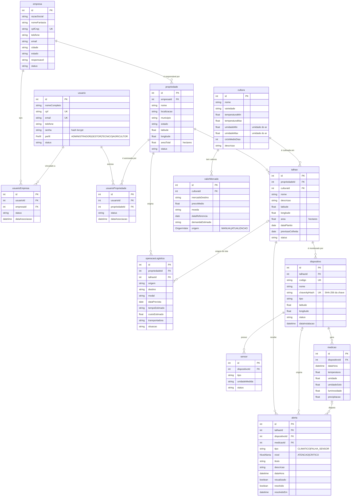

# SIVALE — Modelo do banco de dados (ER)

Fonte da verdade: [`api/prisma/schema.prisma`](../api/prisma/schema.prisma) e as migrations em `api/prisma/migrations`.
Para exportar PNG/SVG, cole o bloco abaixo em https://mermaid.live.

## Decisões de modelagem

- **Usuário ↔ Propriedade é N:N** por `usuarioPropriedade` e **Usuário ↔ Empresa é N:N** por `usuarioEmpresa`; o papel vem de `usuario.perfil` (`ADMINISTRADOR`, `GESTOR`, `TECNICO`, `AGRICULTOR`). No MVP, TÉCNICO e AGRICULTOR têm as mesmas permissões (V2: menor privilégio). O Gestor enxerga as propriedades das empresas vinculadas; os demais, só as propriedades vinculadas. Ver [PERFIS_E_TELAS](PERFIS_E_TELAS.md).
- **Empresa** é o produtor, a cooperativa ou a exportadora. Liga-se a usuários (`usuarioEmpresa`) e propriedades (`propriedade.empresaId`, opcional).
- **Talhão** é a área física dentro da propriedade; a cultura é um atributo dele. Latitude e longitude existem em Propriedade, Talhão e Dispositivo.
- **Dispositivo** (ESP32) pertence a um talhão e tem vários **sensores** (temperatura, umidade). A chave de API do dispositivo é guardada só como hash.
- **Medição** é uma coleta conjunta de temperatura e umidade por dispositivo; solo, luminosidade e precipitação são opcionais.
- **Alerta** nasce de uma medição fora da faixa da cultura (`CLIMATICO`) ou de um dispositivo sem comunicação (`FALHA_SENSOR`). `visualizado` indica que alguém viu; `resolvido` indica que foi tratado. A tabela `Alerta` serve de base para análises futuras (variação, histórico, risco, comparação, indicadores).
- **valorMercado** guarda uma linha por cultura, destino e data de referência (permite histórico). `origem` separa cadastro manual de atualização pelo botão do site; não há job agendado.
- **operacaoLogistica** guarda origem, destino, modal, prazo, custo, transportadora e situação, opcionalmente ligada a um talhão.

## Ajustes pendentes para a 2ª entrega (do planejamento dos dashboards)

| Ajuste | Dashboard |
|---|---|
| Entidade `Colheita` (quantidade prevista e colhida, unidade padronizada) | T3, P3 |
| Faixa de umidade do **solo** na cultura (hoje `umidadeMin/Max` valem para o ar) | T1 |
| Conversão de câmbio para comparar destinos em reais | P4 |
| Recomendações de colheita e exportação (saída do modelo Python) | T3, P4 |
| Estoque e embalagem para calcular volume disponível para venda | P3 (futuro) |
